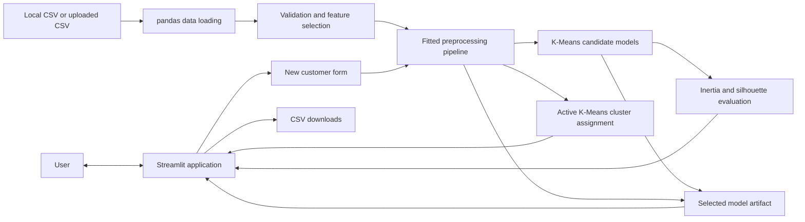
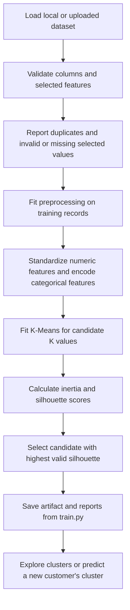
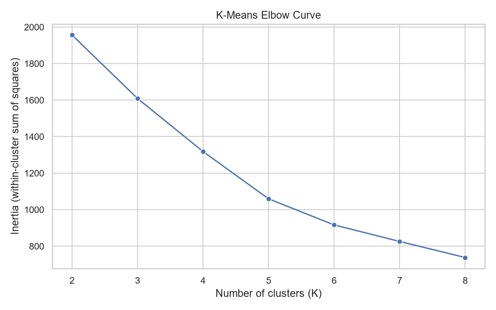
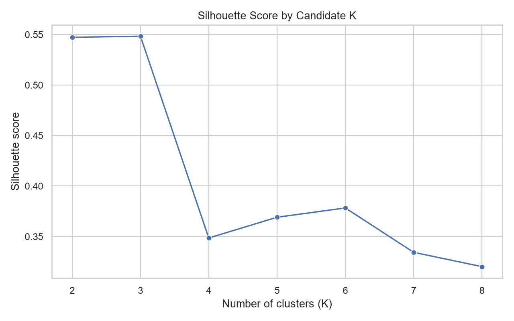
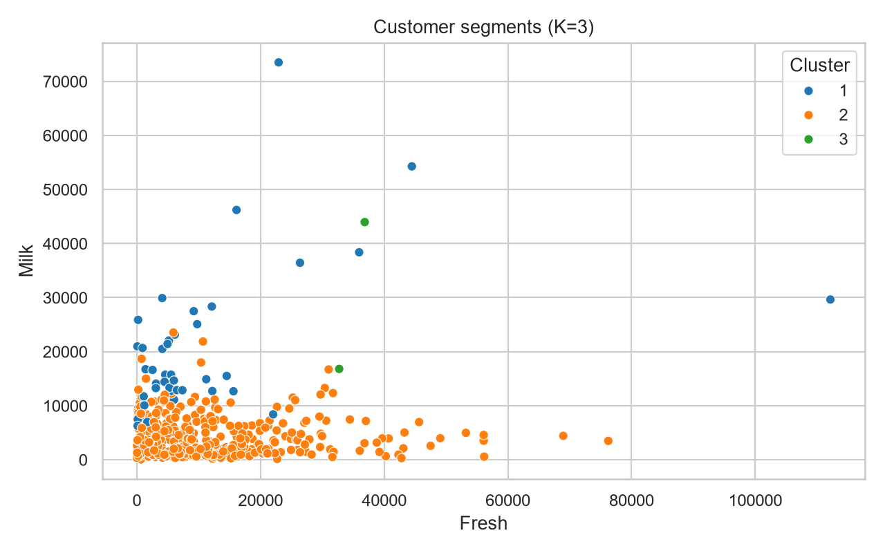

# Customer Segmentation Using Machine Learning

An AIML mini-project that uses **K-Means clustering** to explore customer spending patterns. The project is written in **Python** and provides an interactive **Streamlit** application for data exploration, model evaluation, customer segment analysis, and prediction.

> **Current model:** UCI Wholesale Customers · 440 records · 6 features · K=3 · silhouette score 0.5483

## Table of Contents

- [Project Overview](#project-overview)
- [Problem Statement](#problem-statement)
- [Objectives](#objectives)
- [Key Features](#key-features)
- [Technologies](#technologies)
- [Dataset and Attribution](#dataset-and-attribution)
- [Project Structure](#project-structure)
- [System Architecture](#system-architecture)
- [Machine Learning Workflow](#machine-learning-workflow)
- [How K-Means Works](#how-k-means-works)
- [Preprocessing and Scaling](#preprocessing-and-scaling)
- [Training and Model Selection](#training-and-model-selection)
- [Evaluation Metrics](#evaluation-metrics)
- [Experimental Results](#experimental-results)
- [Cluster Interpretation](#cluster-interpretation)
- [Streamlit Pages](#streamlit-pages)
- [Example Prediction](#example-prediction)
- [Installation and Setup](#installation-and-setup)
- [Using the Application](#using-the-application)
- [Testing](#testing)
- [Troubleshooting](#troubleshooting)
- [Limitations](#limitations)
- [Future Enhancements](#future-enhancements)
- [Conclusion](#conclusion)
- [References](#references)

## Project Overview

Customer segmentation groups records with similar measured characteristics. This project demonstrates an end-to-end unsupervised-learning workflow using the UCI Wholesale Customers dataset. The dashboard supports local and uploaded CSV data, feature selection, candidate-K evaluation, cluster profiles, new-customer prediction, and downloadable results.

Cluster IDs are arbitrary labels. They do not indicate rank, quality, or value, and a predicted cluster is not a guarantee of future customer behavior.

## Problem Statement

Customer and business datasets can contain different spending patterns that are difficult to summarize by inspecting individual rows. This project applies K-Means to group wholesale customers according to their annual spending in product categories. The resulting groups are exploratory summaries that may help identify patterns for further investigation.

## Objectives

- Inspect and validate customer data before training.
- Select relevant clustering features and apply consistent preprocessing.
- Fit K-Means models across a configurable range of cluster counts.
- Compare candidate solutions using inertia and silhouette scores.
- Summarize and visualize the customer groups found in the data.
- Assign a new customer using the active fitted model and preprocessing pipeline.
- Save model results and export computed data for review.

## Key Features

- Dataset preview, dimensions, data types, missing-value counts, duplicate counts, and descriptive statistics.
- CSV upload and selectable clustering features.
- Numeric median imputation and standardization; categorical most-frequent imputation and one-hot encoding.
- Candidate K-Means training with a fixed random seed and configurable K range.
- Inertia, silhouette, cluster-size, and cluster-profile views.
- Prediction with the same fitted preprocessing and model used for training.
- CSV downloads for assigned customers, cluster profiles, and evaluation data with metadata.
- A combined model artifact with feature order, preprocessing, selected K, metrics, source label, dataset fingerprint, and training metadata.
- Compatibility checks to prevent a saved model from being shown with a different active dataset.

## Technologies

| Technology | Use in this project |
| --- | --- |
| Python | Application and machine-learning logic |
| pandas, NumPy | CSV handling, tabular analysis, and numeric operations |
| scikit-learn | Preprocessing, K-Means, inertia, and silhouette score |
| Streamlit | Interactive dashboard |
| Matplotlib, Seaborn | Evaluation and cluster visualizations |
| joblib | Saving and loading the fitted model artifact |

Dependencies are listed in [`requirements.txt`](requirements.txt).

The reusable validation, preprocessing, clustering, and prediction functions are implemented in [`src/segmentation.py`](src/segmentation.py). Automated checks are in [`tests/test_segmentation.py`](tests/test_segmentation.py).

## Dataset and Attribution

The active dataset is the **Wholesale customers** dataset from the [UCI Machine Learning Repository](https://archive.ics.uci.edu/dataset/292/wholesale+customers). UCI describes 440 clients of a wholesale distributor and annual spending in monetary units across product categories.

**Citation:** Cardoso, M. (2013). *Wholesale customers* [Dataset]. UCI Machine Learning Repository. [https://doi.org/10.24432/C5030X](https://doi.org/10.24432/C5030X).

**License:** The UCI record lists the dataset under the [Creative Commons Attribution 4.0 International License (CC BY 4.0)](https://creativecommons.org/licenses/by/4.0/). Retain attribution and check the official record for current terms.

The current CSV is at `data/wholesale+customers/Wholesale customers data.csv`. The repository also contains `data/Mall_Customers.csv`, which is synthetic practice data from an earlier fallback workflow; it is not the source of the current UCI results. See [`data/README.txt`](data/README.txt) for source notes and field details.

### Features used by the current model

The saved model uses these six numeric features, in this order:

| Feature | Meaning |
| --- | --- |
| `Fresh` | Annual spending on fresh products |
| `Milk` | Annual spending on milk products |
| `Grocery` | Annual spending on grocery products |
| `Frozen` | Annual spending on frozen products |
| `Detergents_Paper` | Annual spending on detergents and paper products |
| `Delicassen` | Annual spending on delicatessen products |

UCI describes these values in monetary units (m.u.). `Channel` and `Region` are present in the source file but are not selected features for the current model. UCI identifies `Region` as a target field; it is excluded from this unsupervised clustering experiment.

## Project Structure

```text
customer_segmentation_aiml_project/
|-- app.py
|-- train.py
|-- requirements.txt
|-- src/
|   |-- __init__.py
|   `-- segmentation.py
|-- data/
|   |-- Mall_Customers.csv                 # Synthetic practice data
|   |-- clustered_customers.csv            # Generated customer assignments
|   |-- README.txt
|   |-- wholesale+customers.zip            # UCI archive
|   `-- wholesale+customers/
|       `-- Wholesale customers data.csv    # Active UCI dataset
|-- models/
|   `-- customer_segmentation_artifact.pkl
|-- reports/
|   |-- cluster_evaluation.csv
|   |-- cluster_profiles.csv
|   |-- customer_segments.png
|   |-- elbow_method.png
|   |-- silhouette_scores.png
|   `-- README.txt
`-- tests/
    `-- test_segmentation.py
```

## System Architecture



## Machine Learning Workflow



The Streamlit app can train an uploaded dataset in the current session. The command-line training script saves the selected artifact and generated files to the project directories shown above.

## How K-Means Works

K-Means is an unsupervised algorithm: it receives feature values but no correct cluster labels. It starts with K centers, assigns every record to its nearest center, recalculates the centers, and repeats these steps until assignments stabilize or the iteration limit is reached.

For cluster $C_j$, its centroid is the mean of the feature vectors assigned to that cluster:

$$
\mu_j = \frac{1}{|C_j|} \sum_{x_i \in C_j} x_i
$$

The model minimizes the within-cluster sum of squared Euclidean distances:

$$
J = \sum_{j=1}^{K} \sum_{x_i \in C_j} \lVert x_i - \mu_j \rVert_2^2
$$

This objective is the model's **inertia**. Increasing K usually lowers inertia because more centers can fit the data more closely. A lower inertia alone does not prove a better or more useful segmentation.

## Preprocessing and Scaling

The implementation applies these steps to the selected features:

1. Trims column names and normalizes a small set of known Mall dataset aliases.
2. Rejects missing feature columns and identifier columns such as `CustomerID`.
3. Converts numeric and mixed numeric/text feature values to numbers; invalid and non-finite numeric entries are treated as missing and counted.
4. Removes exact duplicate rows and drops records with missing selected-feature values. Counts are recorded in training metadata.
5. Fits a `ColumnTransformer` on the cleaned training records. Numeric columns pass through median imputation and `StandardScaler`; categorical columns pass through most-frequent imputation and one-hot encoding.

Because rows missing selected features are removed before the transformer is fit, the training imputation steps generally have no missing selected values to fill in this dataset. At prediction time, the same fitted transformer and exact feature order are reused; no new scaler or model is fit for the customer being predicted.

## Training and Model Selection

The current saved run uses `random_state=42`, `n_init=10`, and candidate K values from 2 through 8. Each candidate is fitted on the same transformed feature matrix. The project recommends the candidate with the highest valid silhouette score; this is a comparison rule for this run, not a guarantee of business usefulness or a universal optimum.

The selected model, fitted preprocessing pipeline, ordered feature names, selected K, candidate metrics, clustered records, dataset source, dataset fingerprint, and training metadata are stored together in `models/customer_segmentation_artifact.pkl`.

## Model Evaluation

- **Inertia:** Sum of squared distances from records to their assigned centroids. It usually decreases as K increases. Review the elbow curve for diminishing returns.
- **Silhouette score:** Compares a record's closeness to its own cluster with its separation from another cluster. Scores range from -1 to 1; a larger score can indicate better-separated groups. It is not classification accuracy or a percentage.
- **Cluster counts and profiles:** Show group sizes and feature summaries to help judge whether a mathematical grouping is interpretable.

No classification accuracy, precision, recall, or F1-score is reported because the clustering task has no independent ground-truth labels.

## Experimental Results

The following values were verified against the current saved artifact and evaluation table for the UCI CSV. The run contains 440 input records, uses all six features listed above, and reports zero exact duplicates removed and zero rows removed for missing selected features.

| K | Inertia | Silhouette score |
| ---: | ---: | ---: |
| 2 | 1956.1243 | 0.5472 |
| **3 (selected)** | **1608.4311** | **0.5483** |
| 4 | 1317.8384 | 0.3485 |
| 5 | 1058.7713 | 0.3690 |
| 6 | 915.7413 | 0.3782 |
| 7 | 825.4003 | 0.3343 |
| 8 | 737.3862 | 0.3201 |

K=3 has the highest silhouette score in the tested range, but it exceeds K=2 by only about 0.0011. The score should be interpreted alongside cluster sizes and profiles below.

### Evaluation charts

These charts are generated by the project and stored under `reports/`:







## Cluster Interpretation

The saved run assigns customers to clusters with these sizes and average annual spending values (rounded to one decimal monetary unit):

| Cluster | Customers | Fresh | Milk | Grocery | Frozen | Detergents_Paper | Delicassen |
| ---: | ---: | ---: | ---: | ---: | ---: | ---: | ---: |
| 1 | 45 | 10,440.9 | 19,386.4 | 28,656.1 | 2,190.2 | 13,327.8 | 2,374.2 |
| 2 | 393 | 12,062.9 | 4,115.1 | 5,535.0 | 2,940.7 | 1,696.2 | 1,299.1 |
| 3 | 2 | 34,782.0 | 30,367.0 | 16,898.0 | 48,701.5 | 755.5 | 26,776.0 |

Cluster 1 has relatively high average Milk, Grocery, and Detergents_Paper spending compared with Cluster 2. Cluster 2 is the largest group and has lower averages in those categories. Cluster 3 contains only two customers, with unusually high average Fresh, Frozen, and Delicassen spending. Its small size suggests an unusual or outlier-like pattern; avoid making broad claims about it. Cluster numbers are arbitrary identifiers, not ranks.

## Streamlit Pages

| Page | Purpose |
| --- | --- |
| **Overview** | Shows active data source, row and feature counts, selected K, silhouette score, and saved run metadata. |
| **Dataset Explorer** | Displays a data preview, dimensions, data types, missing values, duplicates, and descriptive statistics. |
| **Train / Upload** | Selects features, candidate K range, and random seed; trains when the user presses the training button. |
| **Evaluation** | Displays candidate-K metrics, elbow and silhouette plots, cluster sizes, profiles, and training time. |
| **Customer Segments** | Filters clusters, plots selected numeric features, displays assigned rows, and downloads customer, profile, and evaluation CSVs. |
| **Predict** | Collects one value per active model feature, applies the saved preprocessing, predicts a cluster, and shows its profile. |

## Example Prediction

The current fitted artifact was checked with the following six inputs in model feature order:

| Feature | Input |
| --- | ---: |
| Fresh | 8504 |
| Milk | 3627 |
| Grocery | 4755.50 |
| Frozen | 1526 |
| Detergents_Paper | 816.50 |
| Delicassen | 965.50 |

**Verified output: Cluster 2.** The dashboard presents this as a similarity-based assignment to a learned cluster, not a prediction guarantee.

## Installation and Setup

Open PowerShell in the project folder:

```powershell
cd "D:\sadeem\project\customer_segmentation_aiml_project"
```

### Create and activate the virtual environment

If `.venv` does not already exist:

```powershell
py -m venv .venv
```

Activate it:

```powershell
.\.venv\Scripts\Activate.ps1
```

If PowerShell blocks activation, either avoid activation and call the environment's executables directly (shown below), or allow scripts for this PowerShell process only:

```powershell
Set-ExecutionPolicy -Scope Process -ExecutionPolicy Bypass
.\.venv\Scripts\Activate.ps1
```

This process-scoped setting is temporary and does not change the machine-wide execution policy.

### Install dependencies

```powershell
python -m pip install --upgrade pip
pip install -r requirements.txt
```

### Train the UCI model

The current dataset is already at the path below. From the project root, run the verified training command:

```powershell
python train.py --dataset "data/wholesale+customers/Wholesale customers data.csv" --features Fresh Milk Grocery Frozen Detergents_Paper Delicassen --source "UCI Wholesale Customers dataset"
```

This command **re-trains and replaces** the saved model artifact and generated reports/clustered CSV. Do not run it if you need to preserve a different saved run without first making a backup. The command-line options are provided by `train.py`; `python train.py --help` lists them.

### Start the Streamlit application

```powershell
streamlit run app.py
```

Streamlit normally prints a local address such as `http://localhost:8501` in the terminal. Open the address it prints; the app is not running until the command has started successfully. If the environment is not activated, use:

```powershell
.\.venv\Scripts\streamlit.exe run app.py
```

## Using the Application

1. Start Streamlit and open the local URL printed in the terminal.
2. Review the active source, model configuration, and metrics on **Overview**.
3. Use **Dataset Explorer** to inspect the currently active CSV.
4. On **Train / Upload**, select the desired features and K range, then explicitly train. A CSV can be selected using **Active dataset CSV** in the sidebar.
5. Review candidate scores, cluster sizes, profiles, and plots on **Evaluation**.
6. Use **Customer Segments** to filter and inspect assigned customers or download CSV results.
7. On **Predict**, enter one value for each feature shown by the active model and request a cluster assignment.

The app rejects or invalidates a saved artifact when it is incompatible with the active data. It does not silently train on the bundled synthetic file when a compatible model is absent; it asks the user to train or supply a dataset.

## Testing

Run the unit tests from the project root:

```powershell
python -m unittest discover -s tests -v
```

**Verified result for this README update:** all 6 tests passed. They cover cleaning and invalid numeric values, missing features and identifier rejection, minimum data and candidate-K validation, training and prediction, artifact save/load, dataset fingerprints, and categorical feature-order consistency.

The training command syntax was checked with `python train.py --help`. The full training command was not run as part of this README edit, to avoid overwriting the current saved model artifact. The listed current results and example prediction were read and reproduced from the existing artifact.

## Troubleshooting

| Problem | What to check |
| --- | --- |
| `streamlit` or a package is not recognized | Activate `.venv`, install requirements, or run `.\.venv\Scripts\streamlit.exe run app.py` and `.\.venv\Scripts\python.exe ...` directly. |
| PowerShell blocks `Activate.ps1` | Use the environment executables directly, or the process-scoped execution-policy command above. |
| Dataset file not found | Run commands from the project root and verify `data/wholesale+customers/Wholesale customers data.csv` exists. |
| Missing feature or incompatible CSV | Check exact headers and feature names. The UCI training command requires the six listed spending columns. |
| Too few usable rows or invalid K range | Provide enough valid records for the selected K range; K must be at least 2 and no greater than the supported row limit. |
| Dashboard says no compatible model is available | Confirm the active CSV matches the saved run, then train it from **Train / Upload** or run the UCI training command. |
| CSV parsing error | Check the file encoding, delimiters, quotes, and header row; save a clean comma-separated CSV and retry. |

## Limitations

- K-Means is sensitive to feature selection, scaling, outliers, initial centroids, and K.
- Inertia normally falls as K increases; it cannot select a useful K by itself.
- K=3's silhouette score is only slightly above K=2, and the selected result contains a two-customer cluster.
- Silhouette score measures separation and cohesion, not business value, classification accuracy, or future behavior.
- The dataset describes one wholesale distributor's clients. It should not be generalized to all consumers, retailers, or present-day markets without further evidence.
- Cluster numbers have no stable meaning across retraining runs.
- The Mall-named bundled CSV is synthetic practice data and is not used for the reported UCI experiment.

## Future Enhancements

- Add a report export that bundles current metadata, tables, and plots for academic submission.
- Add an explicit comparison view for K=2 and K=3 to examine the small silhouette difference and cluster-size imbalance.
- Add persistence for uploaded-dataset runs with clear dataset provenance and artifact compatibility checks.
- Add additional clustering methods for comparison while keeping the same preprocessing and evaluation protocol.

## Conclusion

This project demonstrates a reproducible K-Means workflow using real UCI wholesale customer spending data. Its current saved run selected K=3 by the highest silhouette score in the tested range, but the nearly equal K=2 score and two-record cluster show why evaluation metrics should be reviewed alongside the actual segment profiles. The dashboard provides tools for that inspection and for assigning new records using the fitted model.

## References

1. Cardoso, M. (2013). *Wholesale customers* [Dataset]. UCI Machine Learning Repository. [https://doi.org/10.24432/C5030X](https://doi.org/10.24432/C5030X).
2. [Official UCI dataset page](https://archive.ics.uci.edu/dataset/292/wholesale+customers) — dataset description, variables, citation, and license.
3. [Creative Commons Attribution 4.0 International (CC BY 4.0)](https://creativecommons.org/licenses/by/4.0/).
